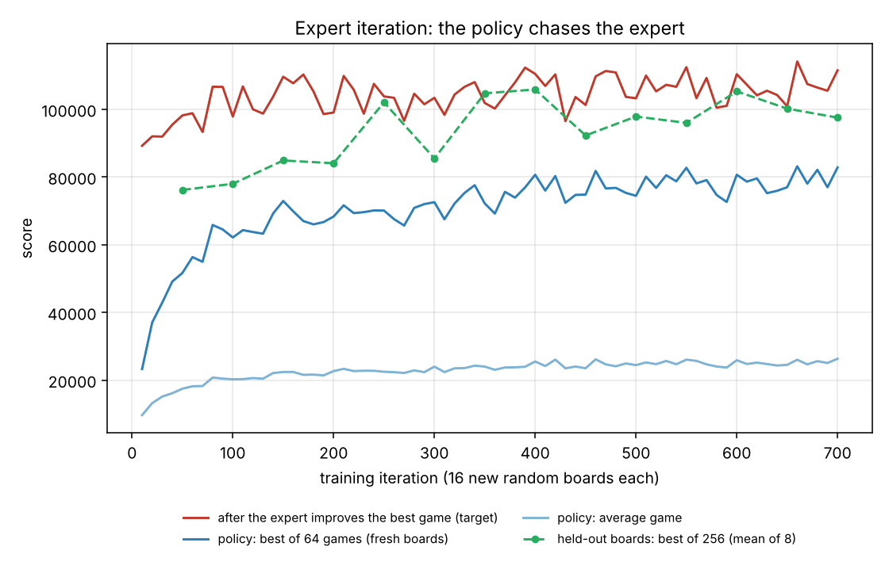

# Reinforcement learning for Kaiju Cats: what I built, why, and what it achieved

This is the long-form explanation of `kaiju_cats/rl/`. Every design decision is listed with the reason for it, including the ones that failed. Practice and learning use only.

**Short version.** A small neural network (84k parameters) learned a policy for the game by *expert iteration* on randomly generated boards. Given a new board, the policy plays thousands of games, a fast local search improves the best ones, and the policy adapts to that board for about two minutes. In one 2-minute run per board it reaches **96-98% of the best-known total** on the 8 real boards (three seeds: 96.2%, 98.4%, 96.8%), and 102% of my search solver's reference on 8 generated boards it never saw. On 4 of the 8 real boards it matched the best-known score on every seed, and on board 4 it found 214,375, which my Python search solver never found in 3 tries (it got 139,875). It does **not** beat the best-known scores: no run on any board found a score above the best-known plan. Whether 223,750 is the best possible on board 8 is not known; neither the search solvers nor the RL pipeline found anything higher.

---

## 1. What problem is the network solving?

The game is deterministic: the same commands always give the same score. A plan assigns a command to each floor. RL needs a *sequential decision problem*, so I use the **lazy-decision MDP** (already described in `docs/INSIGHTS.md`):

* A command only matters at the instant its floor is destroyed. So the game is played forward, and **the agent is asked for a command exactly when a cat breaks a floor** ("Green just broke the top floor of a yellow building: what should it do?").
* **State**: the board, where the cats are, their power, status and direction, the money left, the turn.
* **Action**: 7 choices (none, N, E, S, W, Stomp, Power Up).
* **Reward**: zero until the game ends, then the final score.
* An episode is about 15 decisions long (at most 28 in my tests).

*Why this formulation and not "choose a command for every floor up front"?* Because dead commands (floors nobody breaks) never appear, the budget is tracked as the game goes, and the agent sees the real consequences of earlier choices (where the cats actually are) before it decides.

## 2. The environment (`rl/batch.py`)

* **A compiled, batched environment.** The Gymnasium env in `env.py` wraps the readable Python simulator, which takes tens of microseconds per step. Training needs millions of games, so `BatchEnv` runs hundreds of games at once inside a numba function. A whole 500-game batch plays to the end in about 10 milliseconds.
* **It reuses `fastsim.py`'s game logic** (`move_phase`, `apply_event`) rather than a second implementation, so the RL environment cannot drift from the verified simulator.
* **Verified.** `tests/test_rl.py` plays random games in it and checks every score and cost against the independent readable simulator (0 mismatches on 1,024 games), and feeds the stored best plan back in as actions to reproduce its score exactly.
* **Action masks.** Commands are removed from the policy's choices when they are (a) unaffordable, (b) a direction equal to the way the cat already faces (costs money, changes nothing), or (c) Stomp with no floor left to stomp. This shrinks the search space and teaches the network the budget rule for free. "No command" is always allowed.

## 3. What the network sees (`_observe`)

* **An 18-channel 5x7 image**: tile type (one-hot), floors still standing, where *this* cat is, where the two other cats are, whose bed is whose, and row/column coordinates. It is always from the point of view of the cat being asked, so one network serves all three cats.
* **A 41-number vector**: turn, money left, which cat is deciding, what kind of floor was just broken and what is left of it, and for each cat its status, direction and (log-scaled) power, and how many have reached their beds.
* *Why log-power?* Power spans 0 to over a million. A log scale keeps the inputs in a range the network can use.
* *Why not feed raw coordinates only?* Coordinates are included, but the image form lets convolutions detect patterns ("a plant two tiles ahead") that work on any board.

## 4. The network (`rl/policy.py`)

A small residual CNN: 3x3 convolutions (width 48, 2 residual convolutions), then the feature at the deciding cat's own tile plus a whole-board average, joined with the vector features, then a two-layer head with 7 outputs. 84,471 parameters (a 340 KB file).

* *Why a CNN?* The same local pattern means the same thing on every tile. A flat MLP would have to relearn it at each position.
* *Why small?* On CPU, the network's cost decides how many games I can afford. My first version (width 64, 2 blocks) cost about 4x more per sample than the final one.
* *Why mask inside the network?* A masked softmax gives forbidden commands probability exactly zero.
* *Why no value (critic) head?* None of the training methods below need one.

## 5. Training attempts, in order

### 5.1 REINFORCE with a group baseline ("POMO"): worked slowly, then stalled
Play 32 games on each of 16 fresh random boards. Compare each game with the *average of its own board's games* and make above-average games more likely. The per-board baseline removes board difficulty (boards range 86k-312k) without needing a critic.

Result: average score rose from 8.7k to 13.4k in 75 iterations while the best of 32 games stayed near 21k. I stopped it. (Real best plans score 85k-224k.) It never got a signal strong enough: a good game is a rare, exact chain of commands (save the money, three Power Ups at the right floors, one cat to its bed on the very last turn), so almost every sampled game looks equally bad.

I also fixed two bugs found on the way: the entropy bonus was scaled about 15x too weakly relative to the policy-gradient term, and the entropy number looked like "collapse" when it was mostly forced single-choice decisions after the money ran out.

### 5.2 Expert iteration (`rl/exit.py`): worked
Instead of waiting for a lucky game, **improve the policy's own games with a cheap search and imitate the improved version** (the idea behind AlphaZero):

1. The policy plays 64 games on each of 16 fresh boards.
2. The "expert" takes the best 3 distinct games per board, runs a one-command-change hill climb on each (about a millisecond), picks the winner, then runs an exhaustive **two-command-change** hill climb on it, then my exact one-cat re-routing search (`lazy_dfs.py`, 100k-node cap).
3. The improved plans are replayed through the environment to turn them into (observation, command) pairs, and the network is trained to imitate them (cross-entropy).
4. Repeat on new boards.

Why the expert is strong enough to matter: on early-training games the two-change climb alone triples the score (about 20k to 60k) in under a second.

Decisions that made it work:
* **Replay buffer + 8 gradient steps per iteration.** The expert is the expensive part, so each expert game is learned from many times. This alone doubled the speed of learning (after 40 iterations, best-of-64 was 49k with the buffer vs 23k without).
* **Mask sanitising.** The expert can leave a harmless extra command that the policy's mask forbids (for example turning toward the direction already faced). The first run produced an infinite cross-entropy because of this. Such commands are now replaced by "no command" before replaying; the outcome can only get cheaper.
* **A stronger expert (exact re-routing added)** lifted the teaching targets by about 20% at roughly twice the time per iteration.
* **Fresh boards every iteration** so the network cannot memorise a map. The 8 real boards are never used for training.
* **Threads, not processes, for the expert.** The compiled search releases the Python GIL, so two boards are improved at once on two cores without copying data.



Final training run: 700 iterations, 16 boards each, 93 minutes on 2 CPU cores. The policy's average game on fresh boards rose from 8k to about 25k and its best-of-64 from 23k to about 80k. (The expert improves those best games to about 110k, which is the level the policy is chasing.)

## 6. Solving a board you have never seen (`rl/solve.py`)

`python -m kaiju_cats rl-solve board.txt --seconds 120`

* **Stage 0, pure policy sampling** (4,096 games, a few seconds): reported separately so you can see what the network learned without search.
* **Phase A, explore** (first half of the time): the frozen policy plays thousands of games at a cycle of temperatures (0.8, 1.0, 1.3, 1.7, 2.2) and the expert improves the 8 best of the 24 best distinct games each round. *Why the temperatures?* In a test on board 5 the expert's result went from 109k at temperature 1.0 to 153k at 2.2. A "cold" policy keeps proposing its favourite structure; a "hot" one tries other structures, and different boards need different ones. *Why polish several games and not just the best?* The best raw game is often not the one with the best improved score.
* **Phase B, adapt** (rest of the time): a copy of the policy is trained on this one board. It imitates the best 8 plans found so far, then samples again, so the search concentrates on the strongest structures. This is the same expert-iteration step, with one board.
* **Phase C, polish**: exact re-routing of the best plan.
* **Verification.** Every plan is re-simulated in the independent readable simulator; the score and the $200 budget must match or the call fails. This caught a real bug: plans coming out of the exact search could carry commands on floors that never break, so a plan scoring correctly looked $240 over budget. They are now removed (`lazy_dfs.canonical`).

What I tried and rejected at this stage: adapting with plain policy gradient on one board (about equal on the one board I tried, 245,750 vs 243,500 on a validation board, so I kept expert iteration for consistency), and a single sampling temperature (poor diversity).

## 7. Baselines and results

### Real boards (never trained on)

Best known = best plan from many runs of the C++ solver. Percentages are of the best known. The RL columns are one 2-minute run (seed 0) plus the other two seeds.

| Board | Best known | Random play (16k games) | Per-board CEM (20 s) | Policy sampling alone | **RL pipeline, 2 min** | RL pipeline, other 2 seeds | Search solver, 1 run (mean) | Search solver, best of 3 |
|---|---:|---:|---:|---:|---:|---:|---:|---:|
| board_01 | 85,875 | 26,250 (31%) | 48,750 (57%) | 72,500 (84%) | **85,875 (100%)** | 85,875 / 85,875 | 85,750 (100%) | 85,875 (100%) |
| board_02 | 193,375 | 45,000 (23%) | 99,750 (52%) | 151,375 (78%) | **152,875 (79%)** | 182,406 / 174,625 | 179,489 (93%) | 182,406 (94%) |
| board_03 | 219,375 | 84,750 (39%) | 62,250 (28%) | 140,375 (64%) | **219,375 (100%)** | 219,375 / 219,375 | 216,458 (99%) | 219,375 (100%) |
| board_04 | 214,375 | 40,250 (19%) | 38,750 (18%) | 133,250 (62%) | **214,375 (100%)** | 214,375 / 214,375 | 139,875 (65%) | 139,875 (65%) |
| board_05 | 177,875 | 60,125 (34%) | 79,500 (45%) | 86,375 (49%) | **167,625 (94%)** | 167,625 / 153,125 | 173,208 (97%) | 176,125 (99%) |
| board_06 | 136,125 | 24,875 (18%) | 27,125 (20%) | 111,875 (82%) | **136,125 (100%)** | 135,875 / 135,875 | 133,875 (98%) | 133,875 (98%) |
| board_07 | 115,750 | 25,000 (22%) | 29,750 (26%) | 95,000 (82%) | **115,250 (100%)** | 115,250 / 115,250 | 106,417 (92%) | 115,250 (100%) |
| board_08 | 223,750 | 64,500 (29%) | 122,875 (55%) | 180,625 (81%) | **223,750 (100%)** | 223,750 / 223,750 | 214,958 (96%) | 223,750 (100%) |
| **All 8 (sum)** | 1,366,500 | 27% | 37% | 71% | **96%** | | 91% | 93% |

### Held-out generated boards

The policy never saw these during training and the solve settings were not tuned on them. Their reference is the best of two runs of the Python search solver; it is not a proven best.

| Validation board | Search solver, best of 2 runs (about 6 min) | Policy sampling alone | **RL pipeline, 2 min** |
|---|---:|---:|---:|
| val_01 | 156,250 | 152,000 (97%) | **168,000 (108%)** |
| val_02 | 77,500 | 75,500 (97%) | **84,125 (109%)** |
| val_03 | 162,250 | 134,250 (83%) | **162,250 (100%)** |
| val_04 | 254,250 | 156,250 (61%) | **256,250 (101%)** |
| val_05 | 99,750 | 105,750 (106%) | **110,250 (111%)** |
| val_06 | 154,000 | 143,500 (93%) | **154,000 (100%)** |
| val_07 | 143,750 | 124,250 (86%) | **143,750 (100%)** |
| val_08 | 216,500 | 138,000 (64%) | **216,500 (100%)** |
| **All 8 (sum)** | 1,264,250 | 81% | **102%** |


Other measurements:

* **Earlier pipeline (v1: one temperature, adapt only, polish only the best game)** scored 87.0% of the best-known total on the real boards (`results/rl_v1_boards_120s.csv`). Adding the temperature cycle, polishing 8 distinct games per round and the explore/adapt split took it to 96% (the same policy, no retraining). Board 5 went from 61% to 94%.
* **Adapting versus not adapting** (100 s runs on boards 2, 5, 8 with a frozen policy vs adaptation): adaptation was better on boards 2 and 5 (182,187 vs 173,875; 176,125 vs 167,625) and worse on board 8 (199,500 vs 223,750). The mix is noisy, so the final pipeline spends half the time on each.
* **Run-to-run variance is large on hard boards.** Board 2 gave 152,875, 182,406 and 174,625 in three seeds; board 5 gave 167,625, 167,625 and 153,125. The best-known plans on those two boards (193,375; 177,875) were not reached by RL.
* **More time helps some boards, not all.** With 300 seconds instead of 120 (seed 0, one run each): board 5 reached 176,125 (99.0%, up from 94%), board 7 reached 115,250 (99.6%, unchanged), and board 2 reached only 158,750 (82%). Board 2's best structure was found by neither RL nor 3 runs of the search solver (best 182,406); only the C++ solver's best seed reached 193,375.


### How to read this
* "Policy sampling alone" is what the network learned, without search or adaptation.
* "RL pipeline" is the full 2-minute solve above (one seed).
* "Search solver" is the Python parallel-tempering solver from the rest of the repo (3 seeds, about 2.7 minutes each, 2 cores).
* "Best known" is the best plan found over many runs of the original C++ solver (stored in the solution library).
* The validation boards were generated like the training boards but never trained on, and their references come from two runs of the Python search solver, so better plans may exist.

## 8. Honest limitations

* **It does not beat the best known scores.** In 24 solves (8 boards x 3 seeds) it never exceeded the best-known plan on any board. It matched the best known on every seed on boards 1, 3, 4 and 8, and fell short on boards 2 and 5 (79-94% and 88-94%). Run-to-run variance is large on the hard boards, so one run can land low.
* **Part of the pipeline is search.** The "expert" is a hand-written local search, and the exact re-routing step is a depth-first search. The network supplies a good starting distribution and board-specific guidance; it does not replace search. If you want a *pure* RL result, look at the "policy sampling alone" column.
* **Tuning leakage.** The training boards are generated and the real boards were never trained on. But the board-time settings (temperature cycle, expert sizes) were chosen after looking at results on real boards 2, 5 and 8. For a clean test use the validation boards.
* **One policy, one training run.** I did not do hyper-parameter sweeps, ablate the network size, or train with multiple seeds; the numbers could move with a different seed.
* **Untested rule.** As elsewhere in the repo, a Power Up on a plant is assumed to be added after the doubling.
* **No result above the best known.** I do not know whether the best known scores are the true optimum.

## 9. Reproduce

```bash
pip install -r requirements.txt            # includes torch
python scripts/train_exit.py --iterations 700 --out runs/policy.pt     # about 90 minutes on 2 cores
cp runs/policy.pt kaiju_cats/data/policy.pt
python scripts/run_rl_benchmark.py boards 120        # your real boards
python scripts/run_rl_benchmark.py boards_val 120    # the held-out generated boards
python -m kaiju_cats rl-solve boards/board_02.txt --seconds 120
```

## 10. Where to take it next

* Training plateaued: the curve (`docs/training_curve.png`) is flat from roughly iteration 350, and the held-out numbers bounce around 100k without a clear trend. More iterations of the same recipe are unlikely to help; a stronger expert or a richer network would be the next thing to try.
* Give the policy a *plan-level* output: predict the bed-arrival order and the big cat first, then condition the commands on that. Board 5 and board 2 seem to need a different "structure" than the policy's default.
* Use the policy as the prior inside the parallel-tempering search instead of the other way around.
